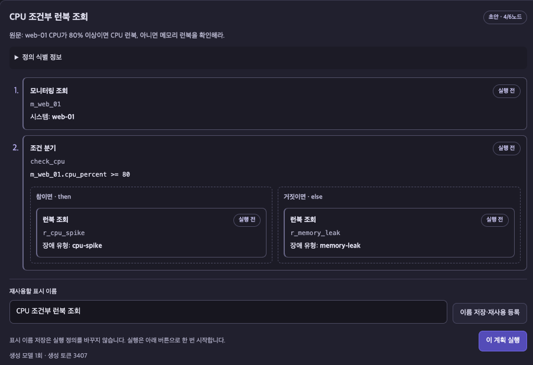
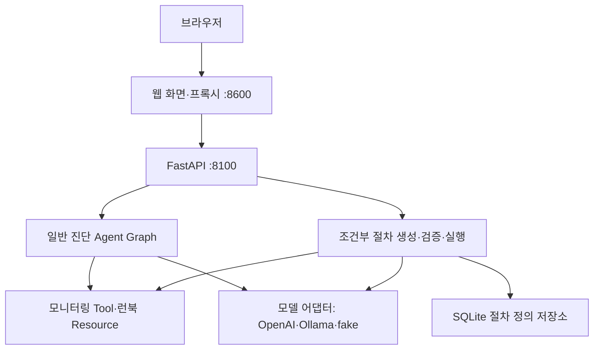

<!-- [추가] 현재 프로젝트의 소개·실행·사용·검증·문서 탐색을 위한 루트 README 전체. -->
# 자연어 기반 조건부 진단 워크플로

기존 운영 인시던트 대응 AI Agent에 **자연어로 지정한 조사 순서와 조건을 실행하는 워크플로**를 추가한 프로젝트입니다.

사용자가 요청한 절차를 LLM이 구조화된 JSON으로 생성하고 서버가 검증합니다. 실행기는 모니터링 응답으로 조건을 계산해 선택한 분기의 MCP 조회만 수행하고, 판단값·완료·건너뜀을 기록합니다. 기존 **일반 진단**과 **조건부 워크플로**를 같은 웹 화면에서 사용할 수 있습니다.

AI 서비스 Mini Project **과제 1: 기존 Base AI Agent 기능 개선·추가**로 진행했습니다.  
광주캠퍼스 · **G094 임해안**

[결과 보고서](doc/assignment1_report.md) · [화면 사용법](doc/workflow_ui.md) · [API 명세](doc/workflow_api.md) · [상세 프로젝트 문서](doc/README.md)

## 주요 개선·추가 기능

| 구분 | 기능 | 구현 내용 |
|---|---|---|
| 개선 | 진단 계획 구조화 | 조사 순서·조건·참/거짓 분기를 표현하는 워크플로 경로 추가 |
| 개선 | 실행 전 검증 | 등록 자원·입력값·조건식·중복 ID·선행 참조·전체 노드 수 검사 |
| 추가 | 자연어 절차 생성 | 질문과 시스템·런북 카탈로그를 실행 가능한 정의로 변환 |
| 추가 | 조건부 MCP 실행 | 실제 응답값으로 조건을 계산하고 선택한 분기만 조회 |
| 추가 | 절차 저장·재사용 | 이름과 정의 해시를 저장하고 같은 절차를 새 관측값으로 재실행 |
| 추가 | 미리보기·실행 경로 표시 | 실행 전 양쪽 분기 확인, 실행 후 판단값·완료·생략 경로 표시 |
| 추가 | 자동화 검증·전후 비교 | 경계값·잘못된 정의·실패 경로 검사와 고정 시나리오 비교 |

관측값·분기·조회 완료 횟수는 코드가 보고하고, 모델은 실제로 읽은 런북을 요약합니다. 요약에는 문서·문단 ID와 근거 원문을 연결하며, 요약 실패 시에도 조회에 성공한 사실 결과를 별도로 제공합니다.



## 실행 방법

프로젝트 루트에서 실행합니다. Python **3.11 이상**이 필요합니다. 웹 화면은 Vue 3 CDN 방식으로 동작해 별도 npm 설치·빌드가 없습니다. Node.js는 프론트엔드 자동화 테스트를 실행할 때 사용합니다.

### 1. Python 환경 준비

처음 실행할 때 가상환경과 의존성을 준비합니다.

```bash
bash sh/setup_venv.sh
```

### 2. 환경 설정

`.env`가 없다면 예시 파일을 복사합니다. 다음 명령은 기존 `.env`를 덮어쓰지 않습니다.

```bash
cp -n .env.example .env
```

실제 설정은 **`.env`**에 작성합니다. 서버는 `.env.example`을 자동으로 읽지 않습니다. OpenAI로 실행하려면 다음 값을 본인 환경에 맞게 채웁니다.

```dotenv
LLM_BACKEND=openai
OPENAI_API_KEY=본인의_OpenAI_API_키

LANGCHAIN_TRACING_V2=true
LANGCHAIN_API_KEY=본인의_LangSmith_API_키
LANGCHAIN_PROJECT=capstone-all-total-openai
```

OpenAI 모델 요청에는 API 사용료가 발생합니다. 실제 키를 담은 `.env`는 Git에서 제외합니다. LangSmith 추적을 사용하지 않는 환경에서는 `LANGCHAIN_TRACING_V2=false`로 설정할 수 있습니다.

<!-- [추가] .env를 바꿨는데 기존 셸 설정이 적용되는 경우를 구분한다. -->
이미 셸에 설정된 환경변수는 `.env`보다 우선합니다. 변경한 백엔드·모델이 적용되지 않으면 아래 `/health` 응답과 현재 터미널의 기존 환경변수를 확인합니다.

### 3. 백엔드 실행

첫 번째 터미널에서 실행합니다.

```bash
./.venv/bin/python3 server.py
```

백엔드 주소는 `http://localhost:8100`입니다. MCP 서버는 백엔드가 stdio 하위 프로세스로 기동합니다.

### 4. 웹 서버 실행

두 번째 터미널에서 실행합니다.

```bash
./.venv/bin/python3 web_demo_server.py
```

브라우저에서 **[http://localhost:8600](http://localhost:8600)**을 엽니다.

설정한 백엔드와 모델명은 다음 주소에서 확인합니다. health 응답은 설정·기동 확인이며 실제 모델 인증이나 응답 성공까지 검사하지는 않습니다.

```bash
curl http://localhost:8100/health
```

설정이나 모델을 변경했다면 실행 중인 백엔드를 `Ctrl+C`로 종료하고 다시 실행합니다.

## OpenAI·Ollama 전환

실제 `.env`의 `LLM_BACKEND`를 변경하고 백엔드를 재시작합니다.

| 백엔드 | 일반 진단 fast 모델 기본값 | 워크플로 생성 모델 기본값 | 보고 모델 기본값 |
|---|---|---|---|
| `openai` | `gpt-4o-mini` | `gpt-4o-mini` | `gpt-4o` |
| `ollama` | `qwen3:0.6b` | `qwen3:8b` | `qwen3:8b` |
| `fake` | 개발용 대역 | 고정 예시용 생성 대역 | 개발용 대역 |

Ollama 서버가 실행 중이고 사용할 모델이 준비된 상태에서 다음과 같이 전환합니다.

```dotenv
LLM_BACKEND=ollama
LANGCHAIN_PROJECT=capstone-all-total-ollama
# 워크플로 생성 모델을 별도로 지정할 때 사용
# OLLAMA_WORKFLOW_MODEL=qwen3:8b
```

일반 진단 모델은 `OLLAMA_FAST_MODEL`, `OLLAMA_QUALITY_MODEL`로 지정할 수 있습니다. 워크플로 생성은 별도 설정이 없으면 현재 Ollama quality 모델을 사용합니다. OpenAI의 모델명은 `OPENAI_FAST_MODEL`, `OPENAI_QUALITY_MODEL`로 지정합니다.

외부 모델 없이 개발 동작을 확인하려면 `LLM_BACKEND=fake`를 사용합니다. fake의 워크플로 생성은 화면의 고정 예시로 확인하며 실제 자연어 이해 성능을 평가하는 용도로 사용하지 않습니다.

LangSmith는 `.env.example`과 같은 `LANGCHAIN_*` 설정을 사용합니다. 같은 용도의 `LANGSMITH_*` 별칭을 중복 설정하면 적용 값이 달라질 수 있으므로 하나의 설정 방식으로 관리합니다.

## 사용 방법

### 일반 진단

**일반 진단** 탭에서 장애 상황을 입력합니다. 기존 Agent Graph가 계획·조회·분석·보고를 수행합니다.

```text
payments-service 결제 응답이 느려지고 CPU가 치솟았어요. 원인을 확인해줘.
```

### 조건부 워크플로

1. **조건부 워크플로** 탭에서 조사 순서와 조건을 입력합니다.
2. **절차 생성 · 실행 안 함**을 누릅니다.
3. 미리보기에서 시스템·조건식·양쪽 분기를 확인합니다.
4. 재사용할 절차는 이름을 지정해 **이름 저장·재사용 등록**을 누릅니다.
5. **이 계획 실행**을 눌러 조회를 시작합니다. 저장 전 초안도 실행할 수 있습니다.
6. 조건 판단값·선택 분기·건너뛴 단계·조회 자료·최종 보고를 확인합니다.

**예시 1 — CPU 기준에 따른 런북 선택**

```text
web-01 CPU가 80% 이상이면 CPU 런북, 아니면 메모리 런북을 확인해라.
```

CPU가 80% 미만이면 메모리 런북을 읽고 CPU 런북을 건너뜁니다. 메모리 런북 조회는 사용자가 지정한 분기를 따른 결과이며 메모리 장애 확정을 의미하지 않습니다.

**예시 2 — 정상 상태일 때 추가 조회 생략**

```text
web-01을 조회하고 상태가 healthy면 추가 조회하지 말고, 아니면 CPU 런북을 확인해줘.
```

healthy 상태라면 모니터링 조회 후 런북 조회를 생략합니다. 저장한 절차는 목록에서 다시 열어 새 관측값으로 실행할 수 있습니다. 생성·이름 저장만으로 모니터링·런북 본문 조회를 시작하지 않습니다.

## 구성과 기술



조건부 실행 그래프는 `prepare → execute → write → validate_report → finalize`의 고정 5노드입니다. 사용자별 if/else는 `execute` 내부 실행기가 해석합니다. 요약 검증에 실패하면 요약만 재작성하고 MCP 조회를 반복하지 않습니다.

주요 기술은 **LangGraph, MCP, LLM 구조화 출력, Pydantic, 의존성 주입·모듈화, SQLite, FastAPI·HTTPX·asyncio, Vue 3·POST SSE, LangSmith**입니다.

```text
.
├── server.py                 # 백엔드 진입점·모델/MCP/저장소 구성
├── web_demo_server.py        # 웹 화면·정적 자산·API 프록시
├── web_chat.html             # 일반 진단·조건부 워크플로 탭
├── agent/
│   ├── graph.py              # 기존 일반 진단 그래프
│   ├── mcp_client.py         # MCP 연결·Tool/Resource 탐색·호출
│   └── workflow/
│       ├── compiler.py       # 자연어 절차 생성·수정 생성
│       ├── models.py         # 절차·조건·결과의 타입·구조
│       ├── validator.py      # 자원·ID·참조 검증
│       ├── intent.py         # 지원 표현 범위의 원문 제약 대조
│       ├── executor.py       # 실제 조건 계산·선택 분기 조회
│       ├── graph.py          # 신규 실행·보고·검증 그래프
│       ├── report_content.py # 실행 사실 출력·문단 참조 요약 검사
│       ├── store.py          # SQLite 절차 정의 저장
│       ├── service.py        # 생성·저장·실행 서비스
│       └── api.py            # HTTP·POST SSE API
├── web/                     # Vue 워크플로 화면·SSE 처리
├── prompts/                 # 워크플로 생성·보고 프롬프트
├── data/                    # 모의 모니터링 값·런북 파일
├── eval/                    # 고정 시나리오·비교 평가기
├── tests/                   # Python·Node 자동화 검사
└── doc/                     # 결과 보고서·실행·구현·평가 문서
```

## 검증과 비교 평가

### 자동화 검증

Python 테스트는 프로젝트 가상환경에서 실행합니다. 아래 추적 해제는 **테스트 자료의 외부 전송을 끄는 설정**이며 실제 서버 실행의 `.env` 설정과 구분합니다.

```bash
LANGSMITH_TRACING=false LANGCHAIN_TRACING_V2=false \
  ./.venv/bin/python3 -B -m unittest discover -s tests -q
```

프론트엔드의 SSE·상태 제어 테스트는 Node.js로 실행합니다. 개발 문서에서는 Node 22 이상을 권장합니다.

```bash
node --test tests/test_workflow_stream.cjs tests/test_workflow_ui.cjs
```

CPU 경계값, 참/거짓·빈 분기, 잘못된 정의와 참조, 저장·재사용, 모델·MCP 실패, 연결 종료, 요약 재작성 시 조회 미반복을 검사합니다. 테스트 대역을 사용하는 검사와 실제 모델 API 평가는 별도로 관리합니다.

<!-- [추가] 자동화 검사의 확인 시점·대역 범위를 실제 모델 평가와 구분한다. -->
2026-10-22에 확인한 프로젝트 전체 검사 기록은 Python **381개**, Node **46개** 통과입니다. Python 검사에는 정답 AST 기반 34개 시나리오의 실행·보고와 무효 정의 12개의 조회 전 차단이 포함됩니다. 모델·MCP 대역을 사용한 검사이며, 자연어 생성과 실제 모델 요약의 전체 정확도를 뜻하지 않습니다.

### 초기 일반 진단·워크플로 비교

최초 OpenAI 비교 평가에서는 같은 지원 18문항·고정 관측 시나리오 34개에 다음 결과를 기록했습니다.

| 지표 | 기존 일반 진단 | 초기 워크플로(v1) |
|---|---:|---:|
| 기대 실행 경로 일치 | 7/34 · 20.6% | 27/34 · 79.4% |
| 추가·중복 MCP 도메인 조회 | 28회 | 1회 |

이는 **2026-10-21 최초 v1 평가 기록**입니다. 실제 OpenAI 모델과 고정 자료를 반환하는 MCP 내부 대역을 사용했습니다. 경로 일치는 답변 전체의 정확도가 아니며, 위 수치로 일반적인 속도·비용 우위를 주장하지 않습니다.

<!-- [추가] 단계별 보완 결과를 초기 전후 비교와 별도 표로 제시한다. -->
### 워크플로 보완 후 회귀 평가

초기 평가에서 발견한 오류를 보완한 뒤 **같은 24문항·40시나리오**로 워크플로를 다시 평가했습니다. 지원 요청은 18문항·34시나리오이며, 미지원 요청은 6문항입니다. 아래 v1·v2·v3는 워크플로의 구현·보완 단계 이름입니다.

| 지표 | 최초(v1) | 1차 보완(v2) | 2차 보완(v3) |
|---|---:|---:|---:|
| 최초 후보 의미 일치 | 13/18 | 17/18 | 18/18 |
| 승인된 최종 절차 의미 일치 | 13/18 | 16/18 | 18/18 |
| 지원 시나리오 경로 일치 | 27/34 | 30/34 | 34/34 |
| 지원 시나리오 추가·중복 조회 | 1회 | 0회 | 0회 |
| 미지원 요청의 명시적 거절 | 3/6 | 6/6 | 6/6 |
| 미지원 요청 도메인 조회 | 4회 | 0회 | 0회 |

v2·v3에서는 보완한 워크플로만 재평가했고 일반 진단은 앞선 초기 비교 기록을 유지했습니다. 이미 수정에 참고한 같은 문항의 회귀 평가이므로, 18/18·34/34를 새로운 질문이나 전체 답변의 정확도로 일반화하지 않습니다. 조건·실패 사례는 [최초 비교](doc/workflow_openai_results.md)와 [후속 회귀 평가](doc/workflow_openai_regression_results.md)에 정리했습니다.

<!-- [추가] v3 수치를 현재 소스의 최종 평가로 오해하지 않도록 미실시 범위를 명시한다. -->
**현재 코드는 v3 이후 보고 방식을 보완한 상태이며, 해당 변경까지 반영한 전체 전후 OpenAI 비교는 아직 다시 수행하지 않았습니다.** 현재 코드의 자동화 검사, 화면 기능 시연, 과거 버전의 실제 모델 평가를 각각 구분합니다.

### 토큰 기록 기반 비용 추정

<!-- [추가] 비용 증가와 생성·재사용 조건을 숨기지 않고 최초 비교의 후처리 결과로 표시한다. -->
초기 v1의 지원 34개 시나리오에서 캐시 할인 전 비용은 일반 진단 **약 $0.07827**, 워크플로 **약 $0.21613**으로 추정됐습니다. 공급자 실측 입력·출력 토큰에 2026-10-22 확인한 공식 모델별 단가를 적용했으며, 문항별 절차 생성 1회와 저장 정의의 시나리오별 재사용을 포함한 조건입니다. 실제 청구액이나 현재 버전의 비용을 뜻하지 않습니다. 계산 근거·할인 미반영 범위는 [비용 분석](doc/workflow_cost_analysis.md)에 있습니다.

보관된 평가 원자료가 있는 환경에서는 외부 API 호출 없이 다시 계산할 수 있습니다. 원자료와 계산 JSON은 `eval/results/`의 로컬 산출물로 Git에서 제외합니다.

```bash
python3 -B eval/calculate_openai_costs.py
```

## 지원 범위와 한계

- 모니터링 조회·런북 조회·최상위 if/else를 지원합니다. 입력은 최대 2,000자, 절차는 미선택 분기를 포함해 최대 6노드입니다.
- 조건은 앞선 최상위 모니터링의 CPU·메모리 수치 또는 상태를 참조합니다. 중첩 조건·반복·운영 변경은 지원하지 않습니다.
- 모니터링 값은 `data/monitoring.json`의 모의 자료에 호출별 변동을 더한 값입니다. 런북은 `data/runbooks/`의 파일 본문을 읽습니다.
- SQLite에는 절차 정의를 저장합니다. 실행 이력 영구 저장·이벤트 재접속 재생·취소 API·체크포인트 재개는 구현 범위에 포함하지 않았습니다.
- 구조·참조·일부 수치 검증을 통과해도 모델 요약의 전제조건·주의사항·인과 관계까지 완전히 검증한 것은 아닙니다. 근거 원문을 함께 확인해야 합니다.

## 문서 안내

<!-- [추가] 실측 토큰을 공식 단가로 환산한 비용 분석과 오프라인 계산기를 안내한다. -->

| 문서 | 내용 |
|---|---|
| [과제 결과 보고서](doc/assignment1_report.md) | 개선·추가 task, 핵심 코드, 실제 캡처, 평가, 한계·회고 |
| [상세 프로젝트 문서](doc/README.md) | 기존 일반 진단 구조·실행 스크립트·사용 흐름 |
| [워크플로 화면 사용법](doc/workflow_ui.md) | 생성·미리보기·저장·실행·오류·연결 종료 |
| [워크플로 API 명세](doc/workflow_api.md) | 요청·응답·정의 해시·오류 코드·환경변수 |
| [구현 계획·진행 기록](doc/workflow_implementation_plan.md) | 구현 범위와 개발 단계 |
| [평가 방법](doc/workflow_evaluation.md) | 문항·고정 자료·지표·평가 실행 방법 |
| [최초 OpenAI 비교 평가](doc/workflow_openai_results.md) | 초기 v1의 실측과 실패 사례 |
| [후속 회귀 평가](doc/workflow_openai_regression_results.md) | 같은 문항을 활용한 보완 후 회귀 기록 |
| [OpenAI 비용 분석](doc/workflow_cost_analysis.md) | 초기 전후 비교·회귀 기록의 토큰 기반 추정 비용과 계산 방법 |
| [보고 정확성 보완](doc/workflow_report_accuracy.md) | 코드 작성 사실 보고·문단 참조 요약·검증 한계 |
