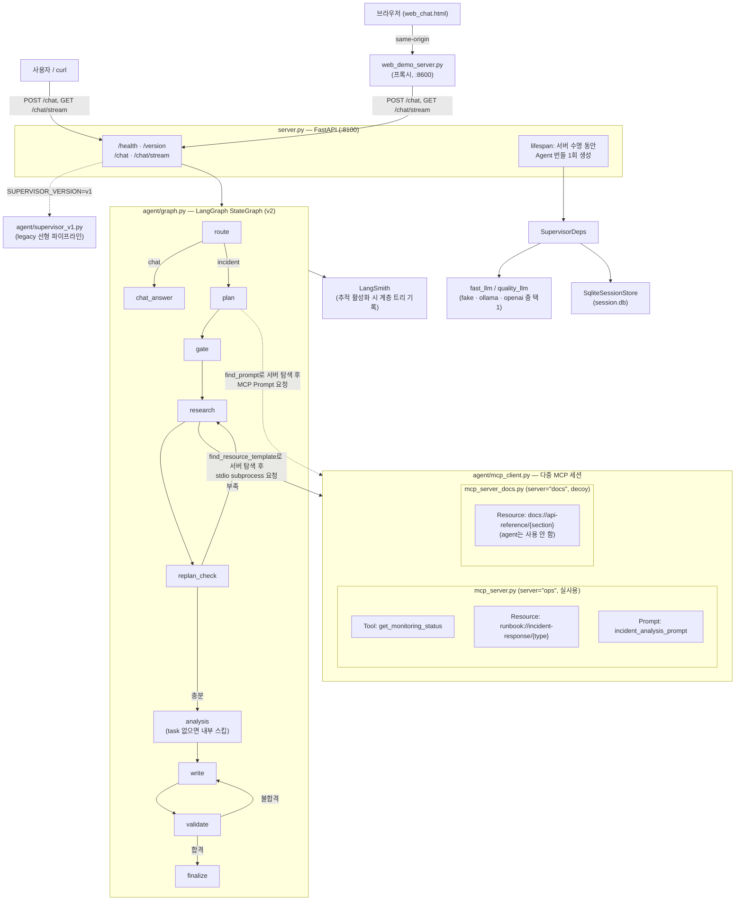
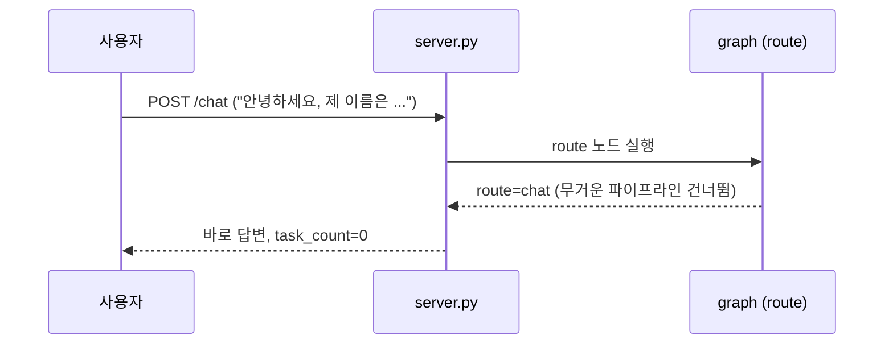
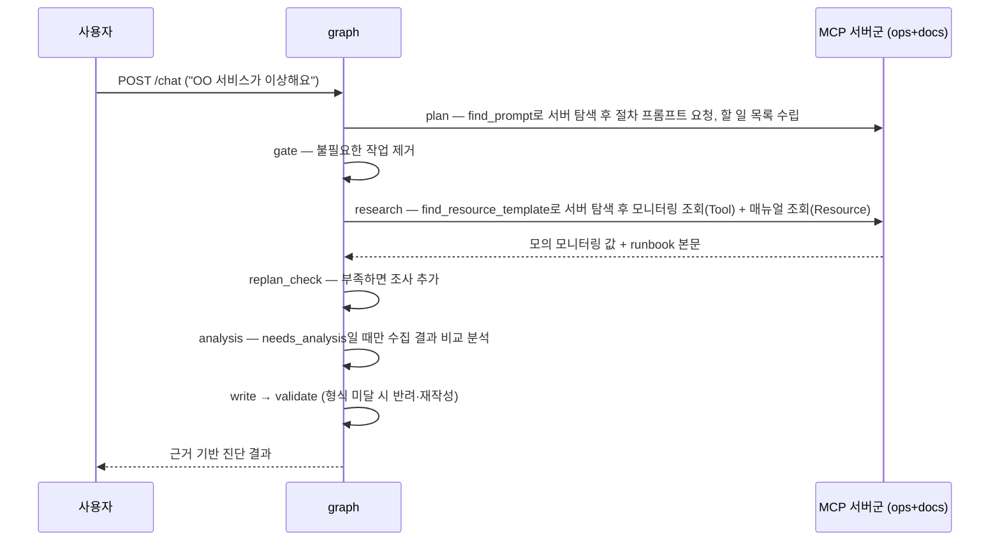
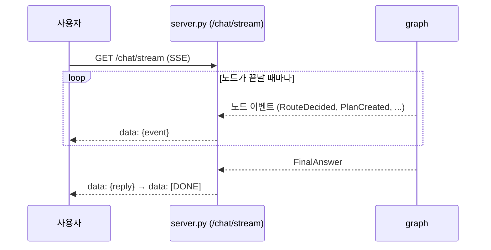
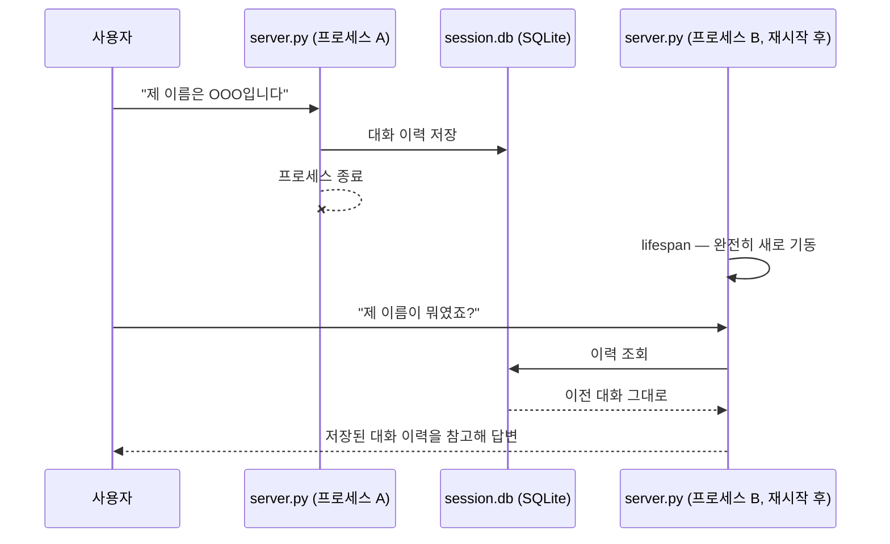
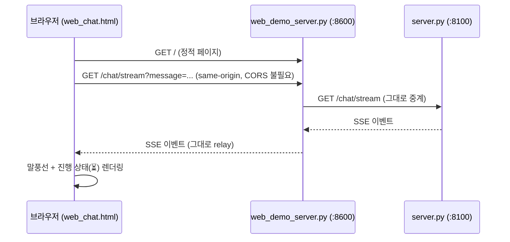

# all_total_vue — 운영 인시던트 대응 에이전트 (Vue 프론트엔드 버전)

<!-- [수정] 기존 Vue 기반 프로젝트에 추가된 워크플로 화면·백엔드와 사용 문서를 반영한다. -->

`all_total`을 기반으로 브라우저 채팅 화면을 **Vue 3**(CDN 글로벌 빌드, 별도 빌드 단계
없음)로 구성한 프로젝트다. 기존 진단 경로에 자연어 조건부 워크플로 생성·저장·실행 API와 화면을 추가했다.

<!-- [추가] 새 API의 실행 예시·저장·해시·오류 계약으로 연결한다. -->

워크플로 기능은 [화면 사용법·코드 역할](workflow_ui.md), [API 사용법](workflow_api.md), [구현 계획](workflow_implementation_plan.md)을 참고한다.

<!-- [추가] 고정 자료·같은 모델을 사용하는 평가 명령과 실제 전송 승인 범위로 연결한다. -->

비교 평가의 문항·지표·명령은 [평가 안내](workflow_evaluation.md), 승인 후 최초 실측과 실패 사례는 [초기 결과](workflow_openai_results.md), 당시 v3 코드의 동일 문항 재측정은 [회귀 결과](workflow_openai_regression_results.md)에 정리했다.

<!-- [추가] 실제 평가에서 발견한 의도 변경·부분 수행·허위 완료 보완의 구현 설명으로 연결한다. -->

후속 보완의 코드 동작·검사 범위는 [품질 보완 설명](workflow_quality_improvements.md)을 참고한다.

<!-- [추가] 실행 사실과 모델 요약의 분리, 조회 생략·요약 실패 처리 설명이다. -->

보고의 관측값·분기·조회 횟수는 코드가 작성하며, 런북을 읽은 경우에만 문단 참조 요약을 생성한다. [보고 정확성 보완](workflow_report_accuracy.md)을 참고한다.

<!-- [추가] 과제 제출·화면 촬영·발표 구성 문서로 연결한다. -->

과제 제출 자료는 [진행 보고서](assignment1_report.md), [화면 캡처 가이드](assignment1_capture_guide.md), [5분 발표 구성안](assignment1_presentation_plan.md)에 정리했다.

<!-- [추가] 로컬 소형 모델의 조건 왜곡을 재현하고 생성 모델을 분리한 변경으로 연결한다. -->

Ollama의 워크플로 생성은 보고 모델과 같은 모델명(기본 `qwen3:8b`)을 별도의 생성 어댑터에서 사용하며 `OLLAMA_WORKFLOW_MODEL`로 재정의할 수 있다. 일반 진단 fast 모델은 기본 `qwen3:0.6b`다. [로컬 오류 재현·수정·재시작 방법](workflow_ollama_local.md)을 참고한다.

<!-- [추가] 일반 진단 중 health·카탈로그·목록 정체의 원인과 수정·재시작 안내다. -->

일반 진단 중 다른 API까지 시간 초과되던 문제는 [응답 정체 수정 기록](general_diagnosis_timeout.md)에 정리했다. 동기 모델 호출을 스레드로 분리했으며 적용하려면 백엔드와 웹 서버를 재시작한다.
`http://localhost:8600`의 **조건부 워크플로** 탭에서 생성·미리보기·저장·실행할 수 있다. 아래 구성도는 기존 진단 경로를 설명한다.

<!-- [추가] 현재 MCP 모니터링 데이터가 프로젝트의 모의 자료임을 명시한다. -->

모니터링 Tool은 `data/monitoring.json`의 기준값에 호출별 변동을 더해 반환한다. 화면의 CPU·메모리는 이 모의 자료에서 나온 값이며, 런북은 `data/runbooks/`의 실제 파일 본문이다.

Wave 1~15가 각각 증명한 패턴(싱글턴·MCP·SSE·라우팅·게이트·재계획·검증·재시도·병렬·비용분리·
세션·주입·버전 토글·가드)을 전부 조립한 **실제 동작하는 에이전트 서비스**다. LLM 자리는
`fake`(결정론)/`ollama`(로컬 실모델)/`openai`(실제 API) 세 백엔드 중 하나를 선택할 수 있다.

<!-- [수정] 추적 활성화와 실제 평가 실행을 구분하고 자동 평가·피드백을 보장하지 않는다. -->

LangSmith 추적과 유효한 키를 설정한 실행은 계층 트리로 기록할 수 있다. 신규 워크플로의 비교 평가는 자체 `eval/` 실행기가 로컬 결과로 남기며, 평가 CLI는 LangSmith 자동 전송을 끈다. trace 기록만으로 평가·피드백이 자동 생성되지는 않는다.

## 주요 실행 방법

**맨 처음 한 번만**: 이 폴더를 처음 받았다면(학생 배포 등) `.venv`부터 만든다.

```bash
bash sh/setup_venv.sh
```

<!-- [추가] 현재 .env.example과 일치하는 직접 실행·백엔드 전환 방법이다. -->

이미 환경이 준비됐다면 [.env.example](../.env.example)을 참고해 실제 `.env`의 키와 설정을 채운다. 서버는 `.env`를 읽으며 `.env.example`을 자동으로 읽지는 않는다.

- OpenAI: `LLM_BACKEND=openai`. 기본 생성 모델은 `gpt-4o-mini`, 보고 모델은 `gpt-4o`다.
- Ollama: `LLM_BACKEND=ollama`. Ollama를 실행해 두고, 기본 일반 진단 fast 모델 `qwen3:0.6b`와 보고·워크플로 생성 모델 `qwen3:8b`를 사용한다. 생성 모델은 `OLLAMA_WORKFLOW_MODEL`로 바꿀 수 있다.
- fake: `LLM_BACKEND=fake`. 실제 모델 API 없이 개발용 대역을 사용한다.

LangSmith는 `LANGCHAIN_TRACING_V2`, `LANGCHAIN_API_KEY`, `LANGCHAIN_PROJECT`로 설정한다. 프로젝트를 구분하려면 OpenAI는 `capstone-all-total-openai`, Ollama는 `capstone-all-total-ollama`로 정한다. 같은 용도의 `LANGSMITH_*` 별칭이 `.env`나 셸에 남아 있으면 우선 적용될 수 있으므로 중복 설정을 정리한다.

프로젝트 루트의 첫 번째 터미널에서 백엔드를 실행한다.

```bash
./.venv/bin/python3 server.py
```

별도 터미널에서 웹 서버를 실행한다.

```bash
./.venv/bin/python3 web_demo_server.py
```

`http://localhost:8600`을 열고 `/health`의 `llm_backend`, `fast_llm`, `quality_llm`, `workflow_llm`으로 선택한 설정을 확인한다. 설정·모델·버전을 바꿨다면 기존 백엔드를 `Ctrl+C`로 종료하고 다시 실행한다. health는 설정 확인이며 실제 모델 인증·응답 성공 검사는 아니다.

다음 스크립트 실행 방법도 제공한다.

| 방법                     | 명령                                     | 비용            | 용도                                                                                                           |
| ------------------------ | ---------------------------------------- | --------------- | -------------------------------------------------------------------------------------------------------------- |
| Python 가상환경 준비     | `bash sh/setup_venv.sh`                  | 없음            | `.venv` 생성 + `requirements.txt` 설치(최초 1회, 이미 있으면 설치만 재확인)                                    |
| 로컬 Ollama 환경 준비    | `bash sh/setup_ollama.sh`                | 없음(로컬 추론) | 모델(`qwen3:0.6b`/`8b`)이 이미 있으면 재사용, 없으면 새로 pull — `OLLAMA_FORCE_REFRESH=1`을 주면 지우고 재구성 |
| 에이전트만 기동 (로컬)   | `bash sh/run_agent_ollma.sh`             | 없음            | 서버만 띄워두고 직접 curl/웹으로 테스트                                                                        |
| 에이전트만 기동 (OpenAI) | `bash sh/run_agent_openai.sh`            | **과금**        | 위와 동일하되 실제 API 사용 (y/N 확인)                                                                         |
| 브라우저 진단 화면       | `bash sh/run_frontend.sh` (서버 기동 후) | 백엔드에 따름   | `http://localhost:8600`에서 일반 진단·조건부 워크플로 탭 사용                                                  |

`run_agent_*.sh`/`run_frontend.sh`는 `.venv`가 이미 있다는 가정 하에 PATH에
꽂아 쓰기만 한다(`.venv`가 없으면 시스템 `python3`로 조용히 떨어져 패키지
누락 오류가 날 수 있다) — `setup_venv.sh`를 먼저 돌려야 하는 이유다.

<!-- [수정] 실제 두 백엔드 실행 스크립트의 환경 검사·초기화 동작을 정확히 구분한다. -->

`run_agent_ollma.sh`와 `run_agent_openai.sh`는 `.env`가 없으면 작성 안내를 출력하고 종료한다. 두 스크립트는 기존 8100 포트 프로세스를 강제 종료하고 **`session.db`를 삭제**한 뒤 기동하므로, 대화 이력을 보존하는 재시작은 위의 직접 실행 방법을 사용한다. `run_frontend.sh`는 기존 8600 포트 프로세스를 정리한 뒤 웹 서버를 띄운다.

두 백엔드 스크립트는 `LANGCHAIN_PROJECT`를 각각 `capstone-all-total-ollama`, `capstone-all-total-openai`로 지정한다. 별칭 중복이 없고 추적이 켜져 있을 때 해당 프로젝트에 기록된다.

> 더 쉬운 설명과 실제 캡처 화면이 필요하면 [manual_ollma.md](manual_ollma.md)(로컬
> 실모델) · [manual_openai.md](manual_openai.md)(OpenAI API)를 참고.

## 아키텍처 구성도



- **싱글턴**: `server.py`의 `lifespan`에서 `SupervisorDeps`(LLM·세션·MCP 연결)를 정확히
  1회 생성해 `app.state`로 공유한다 — 요청마다 재생성하지 않는다.
- **백엔드 교체**: `LLM_BACKEND` 환경변수 하나로 `fake_llm.py`/`ollama_llm.py`/
  `openai_llm.py`가 바뀌어 꽂히고, 그래프·MCP·세션 코드는 전혀 바뀌지 않는다.
- **버전 토글**: `SUPERVISOR_VERSION=v1`이면 라우팅·게이트·재계획·검증이 없는 legacy
  선형 파이프라인(`supervisor_v1.py`)으로 전환된다. 환경변수 변경 후 백엔드를 재시작해야 한다. 별도 지정이 없으면 `v2`다.
- **MCP는 별도 프로세스**: `mcp_server.py`(ops)가 stdio subprocess로 떠서 서버 수명 동안
  재사용되며, 모니터링 조회(Tool)·대응 매뉴얼(Resource)·진단 절차(Prompt) 세 가지
  capability를 일반 진단에서 사용한다. 신규 조건부 워크플로는 Tool·Resource를 사용하고 생성 프롬프트는 프로젝트의 `prompts/`에서 읽는다.
- **MCP 멀티 서버 탐색**: `mcp_client.py`는 `ops`(mcp_server.py, 실사용)·`docs`
  (mcp_server_docs.py, 내부 API 문서 Resource만 제공하는 decoy) 두 서버에 동시
  연결한다. `plan`/`research` 노드는 어느 서버가 필요한 prompt/resource를 들고
  있는지 코드에 하드코딩하지 않고, `find_prompt()`/`find_resource_template()`로
  연결된 서버들을 먼저 조회한 뒤에야 그 서버로 요청을 보낸다.
- **분석 단계 분리**: `replan_check`가 조사 결과가 충분하다고 판단하면 항상
  `analysis` 노드로 넘어가지만, gate가 살려둔 `agent=="analysis"` task가 없으면
  `analysis_node`가 내부적으로 스킵하고 바로 `write`로 넘어간다 — `needs_analysis`가
  실제로 유효한 경우에만 수집된 모니터링 결과들을 비교 분석한다.

## 주요 유스케이스별 고수준 시퀀스 다이어그램

### 1. 가벼운 대화



### 2. 장애 진단 요청



### 3. 실시간 진행 상황 스트리밍



### 4. 서버 재시작 후 대화 이력 재사용

<!-- [수정] DB를 유지하는 직접 재시작에서 이력을 전달하는 동작이며 답변 정확성을 보장하지 않는다. -->

`session.db`를 유지한 상태로 백엔드를 직접 재시작하면 이전 이력을 모델에 전달한다. 아래 이름 응답은 사용 예시이며 모델의 정확한 기억을 보장하는 검증 결과가 아니다.



### 5. 웹 채팅 화면 사용



## 소스 디렉토리 구조

```
all_total_vue/
├── server.py              # FastAPI 진입점 — lifespan, /health·/version·/chat·/chat/stream·/workflows
├── mcp_server.py           # fastmcp 서버("ops") — Tool/Resource/Prompt (실사용, stdio subprocess)
├── mcp_server_docs.py       # fastmcp 서버("docs") — API 문서 Resource만 제공하는 decoy (멀티 서버 탐색 데모용)
├── web_chat.html            # 채팅·워크플로 탭과 Vue 진입점
├── web_demo_server.py       # 화면·고정 자산 서빙 + 채팅·워크플로 API 프록시(:8600)
├── web/                    # [추가] 빌드 없는 워크플로 화면 모듈
│   ├── workflow.js           # 생성·미리보기·저장·실행·trace·보고
│   ├── workflow.css          # 카드·분기·상태·반응형 스타일
│   └── workflow_stream.js    # fetch POST SSE·UTF-8·종료 검사
├── requirements.txt
├── .env.example
│
├── agent/
│   ├── deps.py              # SupervisorDeps 의존성 주입
│   ├── graph.py              # v2 LangGraph StateGraph (route/plan/gate/research/replan_check/analysis/write/validate/finalize)
│   ├── supervisor_v1.py      # legacy 선형 파이프라인 (버전 토글 대상)
│   ├── fake_llm.py           # LLM_BACKEND=fake — 결정론적 fast/quality 모델 (route/plan/analyze/chat/write)
│   ├── ollama_llm.py         # LLM_BACKEND=ollama — 로컬 실모델 백엔드
│   ├── openai_llm.py         # LLM_BACKEND=openai — 실제 OpenAI API 백엔드
│   ├── mcp_client.py          # MCP 멀티 서버(ops+docs) stdio 클라이언트 — find_resource_template/find_prompt로 서버 탐색 + 의도적 flaky 1회(재시도 데모)
│   ├── retry.py              # Transient 전용 backoff 재시도
│   ├── session_store.py       # SQLite 세션 저장소
│   └── workflow/             # [추가] 조건부 절차 생성·검증·실행·보고·저장·API
│
├── data/
│   ├── monitoring.json        # MCP Tool이 조회하는 모니터링 데이터
│   └── runbooks/               # MCP Resource가 조회하는 대응 매뉴얼 6종
│       ├── db-down.md
│       ├── cpu-spike.md
│       ├── disk-full.md
│       ├── high-latency.md
│       ├── memory-leak.md
│       └── network-timeout.md
│
├── sh/                        # 실행 스크립트 모음 (학생 배포용 — 내부 회귀 테스트 스크립트는 제외)
│   ├── setup_venv.sh            # .venv 생성 + requirements.txt 설치 (맨 처음 1회)
│   ├── setup_ollama.sh          # 로컬 Ollama 모델 준비 — 있으면 재사용, 없으면 pull (리셋은 OLLAMA_FORCE_REFRESH=1)
│   ├── run_agent_ollma.sh       # 에이전트만 기동 — 로컬 실모델
│   ├── run_agent_openai.sh      # 에이전트만 기동 — OpenAI API (과금)
│   ├── run_frontend.sh          # 브라우저 채팅 화면(web_demo_server.py) 기동
│   └── make_student_zip.sh      # .env 제외 + .env.example 포함한 학생 배포용 zip 생성
│
├── doc/                       # 문서
│   ├── README.md                # 이 문서
│   ├── manual_ollma.md          # 사용자 가이드 — 로컬 실모델 기준
│   ├── manual_openai.md         # 사용자 가이드 — OpenAI API 기준
│   ├── regression_test_queries.md  # 시스템명 하드코딩 수정 검증용 회귀 테스트 쿼리 목록
│   ├── workflow_ui.md          # [추가] 워크플로 화면 사용·검증 방법과 코드 역할
│   ├── workflow_api.md         # [추가] 워크플로 요청·오류·저장·설정
│   ├── workflow_implementation_plan.md # [추가] 범위·구현 현황·평가 계획
│   ├── workflow_evaluation.md  # [추가] 자체 비교 평가 실행·지표·한계
│   ├── workflow_openai_results.md # [추가] 최초 v1 OpenAI 비교 평가 기록
│   ├── workflow_openai_regression_results.md # [추가] 당시 v2/v3 회귀 기록
│   ├── workflow_quality_improvements.md # [추가] 생성·실행·보고 검증 보완
│   ├── workflow_report_accuracy.md # [추가] 코드 작성 사실 보고와 문단 참조 요약
│   ├── workflow_ollama_local.md # [추가] Ollama 생성 오류 재현·모델 분리
│   ├── general_diagnosis_timeout.md # [추가] 일반 진단 중 API 정체 보완
│   ├── assignment1_report.md   # [추가] 제출 보고서
│   ├── assignment1_capture_guide.md # [추가] 실제 화면 촬영 안내
│   ├── assignment1_presentation_plan.md # [추가] 5분 발표 구성
│   ├── image_usecase/           # manual_ollma.md 캡처 이미지
│   └── image_usecase_openai/    # manual_openai.md 캡처 이미지
```
