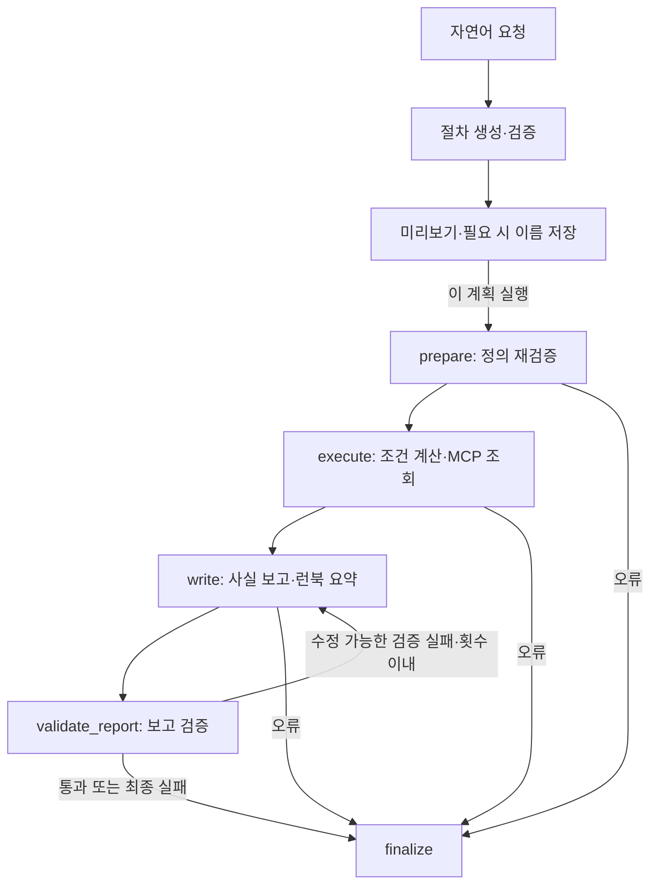
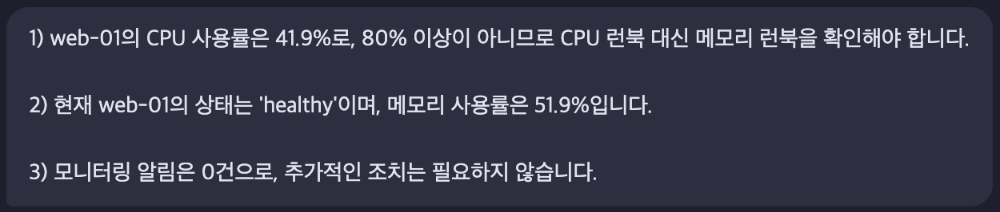
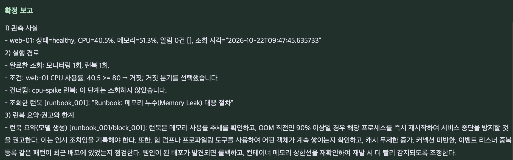
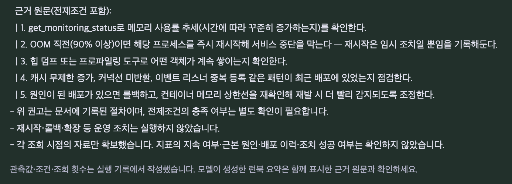
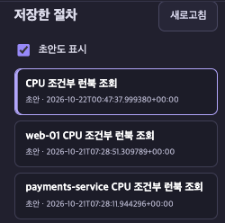
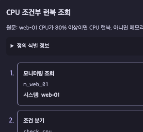
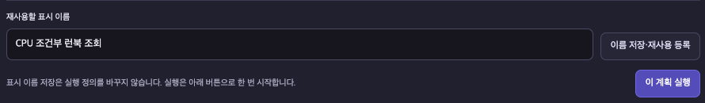
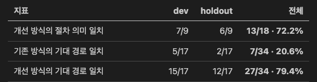
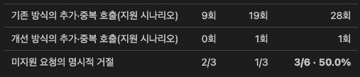

<!-- [추가] 최신 발표 PPT·실제 코드·평가 원기록을 근거로 정리한 과제 1 결과 보고서 전체. -->
**광주캠퍼스 · 번호: G094 · 성명: 임해안**

# AI 서비스 Mini Project 결과 보고서

**선택 과제:** 과제 1 — 기존 Base AI Agent 기능 개선·추가  
**프로젝트명:** 자연어 기반 조건부 진단 워크플로  
**작성일:** 2026-10-22

## 1. 진행 사항 소개

### 1.1 기존 프로젝트와 해결할 문제

기존 프로젝트는 운영 장애에 대한 자연어 요청을 받아 모니터링 정보와 런북을 조회하고 진단 답변을 작성하는 AI Agent이다. 일반 진단은 라우팅·계획·조회·재계획·분석·보고의 흐름으로 동작한다.

사용자가 조사 순서와 조건까지 지정할 때에는 이를 실제 실행 규칙으로 다룰 필요가 있었다. 예를 들어 “CPU가 80% 이상이면 CPU 런북, 아니면 메모리 런북을 확인해라”는 요청에서 중요한 것은 임계값을 설명하는 것뿐 아니라, 관측값에 맞는 런북을 실제로 조회하고 선택하지 않은 조회를 생략하는 것이다. 답변 문장만으로는 이러한 실행 여부를 확인하기 어려웠다.

이를 개선하기 위해 기존 일반 진단을 유지하면서 **자연어 요청을 구조화된 절차로 생성·검증하고, 실제 조회 결과에 따라 분기를 실행하는 별도 워크플로 경로**를 추가했다. 자연어 해석은 LLM이 담당하고, 조건 계산·조회 순서·실행 기록은 코드가 담당한다.

### 1.2 추가·수정한 주요 task

| 구분 | 주요 task | 구현 내용 |
|---|---|---|
| 개선 | 진단 계획 구조 개선 | 실행 순서·조건·참/거짓 분기를 표현하는 워크플로 정의 추가 |
| 개선 | 실행 전 검증 강화 | 시스템·런북·입력값·조건식·ID·참조 관계 검사. 선행 참조만 허용하고 미선택 분기를 포함해 최대 6노드로 제한 |
| 추가 | 자연어 진단 절차 생성 | 사용자 요청과 자원 카탈로그를 실행 가능한 워크플로 JSON으로 변환 |
| 추가 | 조건부 워크플로 실행 | 모니터링 응답으로 조건을 계산하고 선택된 분기의 MCP 조회만 수행 |
| 추가 | 진단 절차 저장·재사용 | 절차 정의·이름·해시를 저장하고, 이후 같은 정의를 새 관측값으로 실행 |
| 추가 | 계획 미리보기·실행 경로 시각화 | 실행 전 양쪽 분기를 표시하고 실행 후 판단값·선택·생략·완료 기록 제공 |
| 추가 | 자동화 검증·성능 비교 | 고정 시나리오로 절차 의미·실행 경로·잘못된 절차 차단·조회 횟수·시간·사용량 검사 |

구현 중에는 실행 사실 출력과 모델 요약의 역할도 분리했다. 관측값·조건·분기·조회 완료 횟수는 코드가 작성하고, 모델은 실제로 읽은 런북을 요약한다. 요약이 실패해도 조회에 성공한 사실 보고를 별도로 제공하도록 보완했다. 신규 모델 호출은 비동기로 처리하고 기존 일반 진단의 동기 모델 호출은 스레드에 분리했다.

### 1.3 사용 흐름과 구현 범위

1. 자연어로 조사 대상·순서·조건을 입력한다.
2. LLM이 절차를 생성하고 서버가 구조·자원·참조·지원 범위의 원문 제약을 검증한다.
3. 미리보기에서 조건과 양쪽 분기를 확인한다.
4. 필요하면 절차에 이름을 붙여 재사용 대상으로 등록한다.
5. **‘이 계획 실행’**을 누르면 새 관측값을 조회하고 조건에 맞는 분기만 실행한다.
6. 단계별 진행 상황과 최종 보고에서 실제 실행 경로를 확인한다.

절차 생성과 이름 저장 단계에서는 모니터링·런북 본문을 조회하지 않는다. 생성 성공 시 절차는 초안으로 저장되며, 이름 저장·재사용 등록을 통해 저장 상태로 전환한다. 실행 요청에서는 화면에서 확인한 정의 해시와 저장된 정의 해시의 일치도 검사한다.

지원 범위는 모니터링 조회, 런북 조회, 최상위 if/else이다. 조건은 앞선 최상위 모니터링의 CPU·메모리 수치 또는 상태를 참조한다. 입력은 최대 2,000자이며, 전체 노드는 미선택 분기까지 포함해 최대 6개다. 중첩 조건·반복·재시작·롤백·확장 같은 운영 변경은 지원하지 않는다.

## 2. 사용한 기술 요소와 신규 코드

### 2.1 기술별 적용 내용

| 기술 요소 | 기존 기반과 추가·개선 내용 |
|---|---|
| LangGraph | 기존 일반 진단 그래프를 활용하면서 조건부 실행·보고·검증용 고정 5노드 그래프 추가 |
| MCP | 기존 서버·클라이언트를 재사용하고, 검증한 절차에 따라 모니터링 Tool과 런북 Resource를 호출하는 실행기 추가 |
| LLM·구조화 출력 | 자연어 요청을 워크플로 JSON으로 생성하고, 런북 요약은 문서·문단 ID를 가진 구조로 반환 |
| Pydantic | 노드·조건·관측값·실행 결과·요약의 타입과 허용 필드 검사 |
| 의존성 주입 | 생성 모델·보고 모델·MCP·카탈로그·저장소를 주입하고 테스트에서는 대역으로 교체 |
| 모듈화 | 생성·의도 검사·정적 검증·실행·보고·저장·서비스·API·화면의 책임 분리 |
| SQLite | 기존 대화 저장과 별도로 절차 정의·해시·표시 이름·초안/저장 상태 관리 |
| FastAPI·HTTPX·asyncio | 워크플로 API와 비동기 모델 호출·실행 처리 추가 |
| Vue 3·POST SSE | 미리보기·선택/생략 경로·진행 이벤트·최종 보고 화면 추가 |
| LangSmith | 생성·실행·보고 단계 추적과 실행 ID·절차 ID·정의 해시 메타데이터 연결 |
| 자동화 테스트·평가기 | 단위·통합·회귀 검사와 동일한 입력·고정 자료를 사용하는 전후 비교 추가 |

로컬 개발에서는 Ollama와 fake 모델을 사용할 수 있고, OpenAI API 어댑터도 구성했다. 실제 OpenAI 비교 평가의 모델 조건은 4절에 별도로 기록했다.

### 2.2 자연어 생성과 실행 전 검증

[compiler.py](../agent/workflow/compiler.py)의 `compile_workflow()`는 질문·등록 자원 카탈로그·응답 스키마를 생성 모델에 전달한다. 아래는 실제 호출 부분의 발췌다.

```python
# [추가] 질문·허용 자원·응답 스키마와 필요한 수정 피드백을 전달한다.
response = await llm.compile_workflow(
    query,
    catalog.to_dict(),
    workflow_response_schema(),
    errors=[issue.model_dump(mode="json") for issue in last_errors] or None,
    previous_response=previous_response,
)
```

생성 결과는 다음 단계로 검사한다.

- [models.py](../agent/workflow/models.py): 모니터링·런북·조건 노드와 숫자/상태 비교의 허용 구조를 정의한다. 추가 필드·암묵적인 타입 변환·비유한 숫자를 제한하고 전체 6노드 상한을 검사한다.
- [validator.py](../agent/workflow/validator.py): 등록 시스템·런북, ID 중복, 참조 대상과 순서를 검사한다. 조건보다 앞에 있는 최상위 모니터링만 참조하게 해 미래 참조·분기 내부 참조·순환 의존을 구조적으로 제한한다.
- [intent.py](../agent/workflow/intent.py): 지원하는 표현 범위에서 원문의 대상·순서·임계값·연산자·분기와 생성 정의를 대조한다. 모든 자연어의 의미를 완전히 판정하는 검사는 아니다.

검증에서 반려되면 오류와 이전 응답을 전달해 한 번 수정 생성한다. 최초를 포함한 생성 시도는 최대 2회다. 통신 오류·명시적 거절·미지원 요청을 동일한 수정 생성 대상으로 계속 반복하지 않는다.

### 2.3 신규 Agent Graph 구성

[agent/workflow/graph.py](../agent/workflow/graph.py)는 `prepare → execute → write → validate_report → finalize`의 고정 그래프다. 사용자 요청마다 LangGraph의 노드를 새로 만드는 구조가 아니라, `execute` 내부의 실행기가 검증된 사용자 절차를 해석한다.



아래는 실제 그래프 구성 부분이다. `partial()`로 각 노드에 필요한 의존성을 주입하고, 조건부 간선으로 오류 종료와 요약 재작성을 연결한다.

```python
# [추가] 실행·보고·검증을 연결하고 종료 조건을 명시한다.
graph = StateGraph(WorkflowGraphState)
graph.add_node("prepare", partial(_prepare, catalog=catalog))
graph.add_node("execute", partial(_execute, mcp=mcp, catalog=catalog))
graph.add_node("write", partial(_write, report_llm=report_llm))
graph.add_node("validate_report", _validate)
graph.add_node("finalize", _finalize)
graph.set_entry_point("prepare")
graph.add_conditional_edges("prepare", lambda s: "finalize" if s["error"] else "execute")
graph.add_conditional_edges("execute", lambda s: "finalize" if s["error"] else "write")
graph.add_conditional_edges("write", lambda s: "finalize" if s["error"] else "validate_report")
graph.add_conditional_edges(
    "validate_report", lambda s: "finalize" if s["error"] or s["report_valid"] else "write"
)
graph.add_edge("finalize", END)
```

이후 `graph.compile(name="conditional-diagnosis-workflow")`로 실행 가능한 그래프를 만든다. 런북 요약은 검증 반려 시 최초를 포함해 최대 3회 작성한다. 이때 MCP 조회 단계로 돌아가지 않으므로 같은 자료를 반복 조회하지 않는다. 런북 조회가 없는 경로는 보고 모델 호출 없이 실행 사실만으로 보고를 완료한다.

### 2.4 실제값에 따른 조건 계산과 분기 실행

[executor.py](../agent/workflow/executor.py)의 `evaluate_condition()`은 앞서 검증한 모니터링 응답에서 조건 필드를 읽고 고정 비교 함수로 계산한다.

```python
# [추가] 모델의 설명 대신 도구 응답의 실제값과 지정한 기준값을 비교한다.
snapshot = self.monitoring[condition.ref]
actual = getattr(snapshot, condition.field)
matched = _COMPARATORS[condition.op](actual, condition.value)
```

비교 결과는 `then_steps` 또는 `else_steps`로 기록한다. `run_condition()`은 미선택 분기를 `skipped`로 남기고 선택된 분기만 순서대로 실행한다.

```python
# [추가] 조건 판단과 생략·실행 경로를 같은 실행 기록에 남긴다.
decision = self.evaluate_condition(step)
self.emit(self.active, "completed", condition=decision)
self.active = None
skipped_branch = "else_steps" if decision.result else "then_steps"
for index, action in enumerate(getattr(step, skipped_branch)):
    self.emit(_ActiveStep(action, f"{path}.{skipped_branch}[{index}]"), "skipped")
for index, action in enumerate(getattr(step, decision.selected_branch)):
    await self.run_action(action, f"{path}.{decision.selected_branch}[{index}]")
```

조건 계산에는 LLM을 사용하지 않는다. 모니터링 실패나 잘못된 응답을 조건의 거짓으로 바꾸어 다른 분기를 실행하지 않고 오류로 처리한다.

### 2.5 MCP Tool과 Resource 조회

모니터링은 기존 `get_monitoring_status` Tool을 사용한다. 시스템 이름은 검증한 노드에서 가져오며, 응답의 타입과 요청 대상 일치 여부도 검사한다.

```python
# [추가] 등록된 시스템의 모니터링 정보를 Tool로 조회한다.
raw = await self.mcp.call_tool(
    MONITORING_TOOL_NAME, {"system_name": step.system}
)
snapshot = MonitoringSnapshot.model_validate(raw)
```

런북은 `runbook://incident-response/{incident_type}` Resource를 사용한다. 필요한 분기를 실행할 때 템플릿을 탐색하고 허용값과 일치하는지 검사한 뒤 본문을 읽는다.

```python
# [추가] 허용한 런북 템플릿으로만 Resource를 읽는다.
server, template = await self.mcp.find_resource_template(RUNBOOK_TEMPLATE_NAME)
if not isinstance(server, str) or not server or template != RUNBOOK_URI_TEMPLATE:
    raise ValueError("허용된 런북 Resource 템플릿이 아닙니다.")
self.runbook_location = (server, template)
server, template = self.runbook_location
body = await self.mcp.read_resource(
    template.format(incident_type=incident_type), server=server
)
```

위 런북 발췌의 탐색 부분은 실제 함수에서 `self.runbook_location is None`일 때 수행하며, 탐색 결과는 현재 실행 안에서 재사용한다. 빈 본문이나 문서 없음 응답도 실패로 처리한다. 모델이 임의 도구 이름·URI·파일 경로를 생성해 그대로 실행하는 방식은 허용하지 않는다.

### 2.6 실행 사실·요약·저장·추적의 역할 분리

[report_content.py](../agent/workflow/report_content.py)는 관측값·조건식·선택 분기·완료 조회 횟수를 실행 기록과 결과 자료에서 출력한다. 런북을 읽은 경우 모델이 실제 문서·문단 ID를 지정해 요약하며, 서버가 해당 원문을 함께 표시한다. 현재 계약은 조회한 런북마다 문단 하나를 선택해 요약하는 형태다. 자료/문단 참조, 일부 수치, 응답 구조, 일부 허위 조치 완료 표현을 검사하지만, 모든 문단의 내용 보존이나 요약의 모든 의미 오류를 판정하는 기능은 아니다.

조회가 성공하면 사실 보고를 먼저 보존한다. 이후 요약이 실패하면 실패 상태를 유지하면서 확인된 조회 결과를 별도로 제공한다. 잘못된 요약을 확정 답변으로 처리하지 않는다.

| 지원 모듈 | 역할 |
|---|---|
| [service.py](../agent/workflow/service.py), [api.py](../agent/workflow/api.py) | 모델·MCP·카탈로그·저장소를 주입받아 생성·등록·실행 API 연결 |
| [store.py](../agent/workflow/store.py), [identity.py](../agent/workflow/identity.py) | SQLite에 절차 정의·표시 이름·상태 저장, 정의 해시로 미리보기와 실행 대상 대조 |
| [reporting.py](../agent/workflow/reporting.py), [report_prompting.py](../agent/workflow/report_prompting.py) | 비동기 요약 호출과 검증 피드백 전달, 프롬프트 구성 |
| [web/workflow.js](../web/workflow.js), [workflow_stream.js](../web/workflow_stream.js) | 생성·미리보기·절차 선택·실행 화면, POST SSE 진행 이벤트 처리 |

LangSmith에는 생성·실행·보고·검증의 단계와 `run_id`, `workflow_id`, `definition_hash`를 연결하도록 계측했다. 추적을 활성화한 서버 실행과 로컬 JSON·Markdown으로 결과를 남기는 자체 비교 평가를 구분한다. 평가 CLI는 LangSmith 자동 전송을 비활성화한다.

SQLite의 저장 대상은 재사용할 **절차 정의**다. 현재 실행의 이벤트와 결과는 제공하지만 실행 이력의 영구 저장, 연결 종료 후 이벤트 재생, 서버 중단 후 체크포인트 재개는 이번 구현 범위에 포함하지 않았다.

## 3. 구현 기능 화면과 최종 실행 결과

<!-- [추가] 그림은 최신 PPT에 삽입된 원본 이미지를 그대로 추출했으며, 이미지 내용은 수정하지 않았다. -->
아래 그림은 [발표 PPT](presentation/assignment1_workflow_notes.pptx)의 2·3·8·9장에 삽입된 실제 캡처를 사용했다. 최종 실행 결과는 모니터링 응답 시각이 2026-10-22인 `web-01` 사례다. 시연 서버의 모니터링 값은 모의 자료이며 호출마다 변할 수 있다.

### 3.1 자연어 생성과 계획 미리보기

**입력 질문**

> web-01 CPU가 80% 이상이면 CPU 런북, 아니면 메모리 런북을 확인해라.

미리보기에는 모니터링 1개, 조건 1개, 양쪽 런북 각 1개로 총 4노드가 표시된다. 조건은 `m_web_01.cpu_percent >= 80`이며 참 분기는 `cpu-spike`, 거짓 분기는 `memory-leak`이다. 이 시점에는 조회를 실행하지 않았고 사용자가 실행 버튼을 눌러야 시작한다.


### 3.2 같은 질문에 대한 일반 진단 결과

일반 진단은 CPU **41.9%**가 80% 미만임을 맞게 판단하고 메모리 런북을 확인해야 한다고 안내했다. healthy 상태와 메모리 사용률 51.9%, 메모리 알림 0건도 설명했다. 다만 이 답변만으로 실제 런북 조회 여부나 호출 횟수까지 확정할 수는 없다.



### 3.3 조건부 워크플로 최종 실행 화면

워크플로는 CPU **40.5%**를 받아 `40.5 >= 80`을 거짓으로 계산했다. 메모리 런북을 조회하고 CPU 런북은 건너뛰었으며, 완료 기록은 모니터링 1회·런북 1회다.

| 확인 항목 | 이번 실행 결과 |
|---|---|
| 시스템·상태 | `web-01`, `healthy` |
| CPU·메모리 | 40.5%, 51.3% |
| 조건 | `40.5 >= 80` → 거짓 |
| 선택 분기 | `else_steps` |
| 완료한 조회 | 모니터링 1회, 메모리 런북 1회 |
| 생략한 조회 | CPU 런북 |
| 실제 운영 변경 | 재시작·롤백·확장 미수행 |





현재 화면의 요약에는 OOM 직전 90% 이상이라는 조건과 재시작이 임시 조치라는 설명이 포함돼 있다. 근거 원문과 함께 표시해 사용자가 요약을 대조할 수 있게 했다. 이 문서의 절차를 조회한 것이며 실제 재시작이나 롤백을 실행했다는 뜻은 아니다.

일반 진단의 41.9%와 워크플로의 40.5%는 각각 다른 호출 시점의 모의 값이다. 이 차이를 정확도 차이로 해석하지 않았다. 또한 메모리 런북 조회는 사용자가 지정한 거짓 분기를 따른 결과이며, 메모리 장애를 탐지했다는 의미는 아니다. 이번 한 문항은 기능 시연이고 여러 시나리오의 전후 정량 비교는 4절에서 구분한다.

### 3.4 절차 목록·미리보기·이름 저장 화면

절차 목록에서 항목을 선택하면 저장된 정의의 미리보기를 불러온다. 표시 이름을 등록해 재사용 대상으로 관리할 수 있으며, 이름 저장은 실행 정의를 바꾸지 않는다. 재실행할 때는 같은 정의로 새 관측값을 조회한다.

| 절차 목록 | 선택한 절차의 미리보기 |
|---|---|
|  |  |



위 그림은 **초안 상태의 목록·선택·이름 등록 입력 화면**이다. 이름 등록 완료 후의 `저장됨` 상태나 펼친 실행 해시를 증명하는 캡처와는 구분한다. 절차 저장·재사용 구현과 저장소 검사는 2.6절의 코드 및 4.4절의 자동화 검증을 근거로 한다.

<!-- [추가] 제출 보완 시 그림 4는 등록 후 새로고침한 '저장됨' 상태·펼친 정의 식별 정보가 함께 보이는 캡처로 교체할 수 있다. -->

## 4. 선택 사항: 동일 입력의 개선 전·후 실측 비교

### 4.1 평가 조건

**측정일은 2026-10-21이며, 아래 수치는 최초 워크플로 v1의 비교 기록이다.** 이후 보고 계약을 변경했으므로 현재 버전의 재측정 결과로 해석하지 않는다.

| 조건 | 적용 내용 |
|---|---|
| 비교 대상 | 기존 일반 진단과 초기 조건부 워크플로(v1) |
| 평가 입력 | 지원 18문항, 고정 관측 시나리오 34개 |
| 모델 설정 | 생성·계획 `gpt-4o-mini`, 보고 `gpt-4o` |
| 자료 | 두 방식에 동일한 모의 모니터링 값·카탈로그·원본 런북 제공 |
| MCP | 같은 자료를 반환하고 호출을 기록하는 프로세스 내부 대역 |
| 평가 범위 | 전체 24문항·40시나리오 중 위 두 지표는 지원 시나리오만 집계 |

모델 호출은 실제 OpenAI API로 수행했다. MCP 내부 대역을 사용했으므로 실제 운영 모니터링이나 MCP 네트워크 성능을 측정한 결과는 아니다.

### 4.2 주요 비교 결과

| 지표 | 기존 일반 진단 | 초기 워크플로(v1) |
|---|---:|---:|
| 기대 실행 경로 일치 | 7/34 · 20.6% | 27/34 · 79.4% |
| 지원 시나리오의 추가·중복 MCP 도메인 조회 | 28회 | 1회 |

기대 실행 경로 일치는 조회 종류·대상·시작 순서가 기대와 일치하는지 평가한 지표다. 추가·중복 조회는 기대한 호출보다 더 수행한 도메인 조회의 수다. 두 지표는 답변 전체의 사실성이나 실제 운영 복구 성공률을 의미하지 않는다.

### 4.3 실제 평가 원기록 캡처와 해석 범위





원기록의 절차 의미 일치 13/18과 미지원 요청의 명시적 거절 3/6도 최초 v1의 수치다. 당시에는 구조가 유효해도 원문의 순서·비교 경계를 잘못 바꾸거나 미지원 요청을 조회로 바꾸는 실패가 남아 있었다. 이후 원문 제약 검사와 보고 보완을 수행했으며, 그 과정은 [후속 품질 보완](workflow_quality_improvements.md)과 [회귀 평가 기록](workflow_openai_regression_results.md)에 별도로 남겼다.

최초 평가에서는 모델 호출 감소가 토큰 감소로 이어지지 않았다. 시간·토큰도 계측했지만 생성 단계, 재사용, 실패, 보고 길이의 차이가 있고 단회·고정 자료 평가여서 일반적인 속도·비용 우위를 주장하지 않는다. 후속 회귀 평가는 이미 수정에 참고한 같은 문항을 사용했으므로 독립적인 미관측 문항의 성능으로 일반화하지 않는다.

근거: [최초 OpenAI 비교 평가 결과](workflow_openai_results.md), [평가 방법·지표 정의](workflow_evaluation.md). 원자료의 로컬 JSON·Markdown 경로는 해당 문서에 연결돼 있으며 평가 산출물은 소스·배포 zip에서 제외된다.

### 4.4 자동화 검증

아래는 **2026-10-22에 확인한 검증 기록**이다. 이번 보고서 작성 과정에서 외부 모델 API나 비교 평가를 새로 실행하지 않았다.

| 검증 | 확인 결과 | 해석 범위 |
|---|---|---|
| Python | 프로젝트 전체 381개 통과 | 단위·통합·회귀 검사 포함. 외부 API와 실제 MCP 서버 요청은 대역으로 교체 |
| Node | 46개 통과 | SSE 해석 30개, Vue setup 제어 흐름 16개 |
| 현재 보고 경로의 고정 시나리오 | 정답 AST 기반 34/34 실행·보고 완료 | Python 검사에 포함. 자연어 생성은 제외하고 MCP·요약 모델은 대역 사용 |
| 무효 정의 검사 | 12/12 조회 전 차단 | 잘못된 정의를 실행기에 넣고 도메인 조회가 0회인지 확인 |

CPU 79.9·80·80.1%의 경계값, healthy 조건의 정방향·역방향 표현, 빈 분기, 잘못된 참조, 모델 거절·오류, MCP 실패, 연결 종료, 요약 재작성 시 조회 미반복을 검사했다. 저장소 검사에서는 등록·재조회·정의 해시와 잘못된 데이터 처리를 확인했다. 테스트 수는 신규 코드만의 개수가 아니라 프로젝트 전체 검사 수다.

검사 위치는 [tests](../tests), 평가 실행기는 [eval](../eval)에 있다. 현재 보고 계약의 검증 범위와 한계는 [보고 정확성 보완](workflow_report_accuracy.md)에 정리했다.

## 5. 느낀 점·한계와 이후 개선

### 5.1 느낀 점

모델이 자연스러운 답변을 작성하는 것과 사용자가 요청한 조회를 실제로 수행하는 것은 따로 검증해야 한다는 점을 배웠다. 절차 정의와 실제 실행 기록을 분리하니 어떤 조건을 계산했고 어떤 작업을 수행하거나 생략했는지 구체적으로 확인할 수 있었다.

또한 JSON 구조와 자료 참조가 유효하다고 요약의 의미까지 정확한 것은 아니었다. 원문의 전제조건·주의사항을 보존하는 검증이 필요했고, 코드가 확정할 수 있는 사실과 모델이 생성하는 설명에 서로 다른 검증 기준을 적용해야 했다.

### 5.2 설계 선택에 따른 한계·트레이드오프

| 설계 선택 | 한계·트레이드오프 | 이후 개선 방향 |
|---|---|---|
| 실행을 검증하기 위해 최대 6노드·최상위 분기로 제한 | 중첩 조건·반복·복잡한 절차를 표현하지 못함. 원문 제약 검사도 지원 표현 범위에 한정 | 새 문항으로 오탐·누락을 평가한 뒤 검증 정책과 함께 지원 범위 확장 |
| 구조화 생성·수정 생성·요약 검증 도입 | 입력 스키마와 수정 피드백이 추가돼 MCP 호출 감소가 토큰·비용 절감을 보장하지 않음 | 현재 계약에서 생성·실행·보고를 분리하고 재사용 횟수별 토큰·응답시간을 반복 비교 |
| 실행 사실은 코드로 출력하고 런북은 모델이 요약 | 요약의 전제조건·비교 방향·주의사항이 누락되거나 의미가 바뀔 수 있음 | 의미 보존 평가 보강, 새 문서·문항을 사용한 최신 OpenAI 재평가 |

현재 시연은 모의 모니터링 자료를 사용했고 정량 비교도 고정 자료·당시 코드에 대한 기록이다. 따라서 운영 장애의 근본 원인 분석 정확도나 복구 성공률까지 입증한 결과로 해석하지 않는다. 실행 기록의 영구 저장과 중단 후 재개도 후속 기능으로 분리한다.

### 5.3 이후 반영할 개선 포인트

1. 기존 수정에 사용하지 않은 자연어 표현·문서로 절차 생성과 요약의 일반화 성능을 평가한다.
2. 요약이 수치뿐 아니라 비교 방향·기간·전제조건·주의사항을 보존했는지 평가한다.
3. 최신 보고 계약으로 OpenAI 전후 비교를 다시 수행하고 최초 생성과 저장 절차 재사용의 시간·사용량을 구분한다.

## 참고 자료

- [발표 PPT](presentation/assignment1_workflow_notes.pptx)
- [과제 안내 PDF](<../AI 서비스 Mini Project_20261020.pdf>)
- [구현 계획과 진행 기록](workflow_implementation_plan.md)
- [워크플로 API](workflow_api.md) · [화면 구성](workflow_ui.md)
- [최초 비교 평가](workflow_openai_results.md) · [후속 회귀 평가](workflow_openai_regression_results.md)
- [평가 방법](workflow_evaluation.md) · [보고 정확성 보완](workflow_report_accuracy.md)
